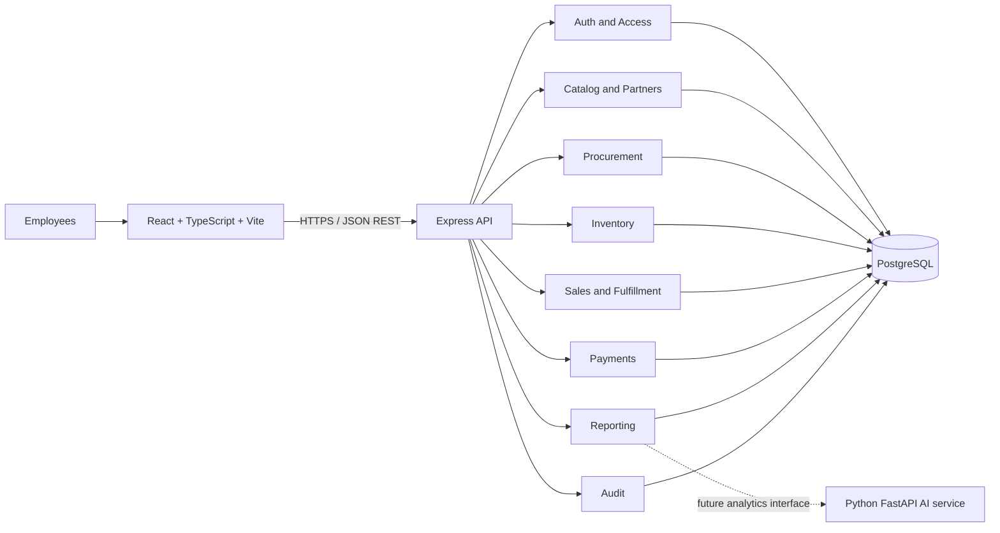

# SupplyChain Pro Architecture

## Overview

Use a TypeScript modular monolith: one React web client and one Express REST API, backed by PostgreSQL through Prisma. Business domains are modules within the API process and share one relational database. Keep modules independently understandable and communicate through service interfaces and domain events written transactionally where needed. Do not introduce microservices until measured scaling or organizational needs justify the operational cost.

## Component responsibilities

- **Web client:** React/TypeScript, Vite, Tailwind CSS, Recharts. Owns presentation, client-side form feedback, routing, and API calls. Client checks are convenience only; authorization is server-side.
- **REST API:** Express/TypeScript. Parses and validates requests, authenticates actors, authorizes operations, coordinates domain services, serializes responses, and applies consistent errors and logging.
- **Domain services:** Own business invariants and transaction boundaries. Routes/controllers must not contain inventory or financial rules.
- **Database:** PostgreSQL is the system of record. Prisma provides typed queries and migrations; use explicit SQL migrations/constraints if a critical invariant is not adequately expressible through Prisma.
- **AI service (future):** Python/FastAPI service consumes permission-filtered, versioned analytical inputs and returns advisory results. It has no direct authority to write stock, orders, payments, or user permissions.

## Backend module boundaries

Suggested modules: `auth`, `users`, `roles`, `catalog`, `partners` (suppliers/customers), `warehouses`, `procurement`, `inventory`, `sales`, `fulfillment`, `payments`, `reports`, `audit`, and `common`. Inventory is the only module allowed to create stock ledger entries or change stock balances. Procurement and sales request inventory operations through its service interfaces. Audit recording can be called by domain services; a transactional outbox can be introduced if external event delivery is later needed.

## Request flow

1. Express middleware assigns request ID, parses safe input, and authenticates the token/session.
2. Route validates path/query/body with a schema and invokes a controller.
3. Controller checks coarse permission and delegates to an application/domain service.
4. Service checks resource scope and state transition, executes Prisma transaction with row locks/conditional updates where needed, writes movements and audit rows, and returns a domain result.
5. Response mapper returns a documented DTO; global error middleware emits `{ error: { code, message, details?, requestId } }` without stack traces or secrets.

## Transaction and concurrency strategy

- Wrap receipt acceptance plus inventory balance update, stock movement, receipt state, and audit event in one database transaction.
- Wrap order confirmation/reservation and dispatch/on-hand reduction/reservation consumption in transactions.
- Wrap transfer dispatch/receipt at each state transition. The ledger must show stock leaving source and entering an in-transit location/state before destination receipt.
- Wrap payment posting and allocation changes in transactions; use compensating entries for reversal.
- Serialize operations affecting a product/warehouse balance using row-level locking or an atomic conditional update that verifies sufficient available quantity. Retry only known serialization/deadlock failures with bounded retries.
- Add unique constraints for document numbers, idempotency keys (scoped by actor/operation), and one balance row per product/warehouse.
- Avoid network calls inside database transactions.

## API conventions

- Prefix `/api/v1`; JSON request/response; UUID IDs; UTC ISO-8601 timestamps.
- Use explicit resource names and status transitions. Return 201 for created resources, 200/204 for successful reads/updates, 400 for malformed input, 401 unauthenticated, 403 unauthorized, 404 unavailable/out-of-scope resource, 409 state/concurrency conflict, 422 business validation, and 500 opaque internal error.
- Paginate list endpoints using page/limit initially, with a maximum limit; standard response `{ data, meta: { page, limit, total } }`.
- Publish OpenAPI 3 specification and Swagger UI in non-production or protected production environment.
- Use idempotency key header for commands where clients may retry after timeout.

## Deployment topology

Initial deployment can use one frontend static host, one API web service, and one managed PostgreSQL instance. Keep staging and production data isolated. Configure TLS, database connection pooling, migration step, health/readiness endpoint, centralized error monitoring, backups, and environment-based secrets. A local Docker Compose setup is recommended for PostgreSQL and repeatable development. Keep AI as an optional service in a later phase.

## Observability

- Structured JSON logs with request ID, actor ID where appropriate, route, result, and latency.
- Redact passwords, tokens, payment secrets, and sensitive request fields.
- Health endpoint checks process readiness; database health is separately observable without exposing internals.
- Track error rate, latency, failed jobs/operations if jobs are introduced, database connections, and backup success.
- Audit log is a business record, not a substitute for operational logs.

## Security architecture

- Hash passwords with bcrypt at an appropriate cost; rate-limit authentication and sensitive endpoints.
- Prefer short-lived access JWT plus rotated, revocable refresh tokens stored hashed server-side (or secure same-site session cookies). Decide browser storage based on deployment/CORS model; avoid persistent bearer tokens in localStorage where feasible.
- Use secure, HttpOnly, SameSite cookies if cookie sessions are selected; implement CSRF defenses for cookie-authenticated mutations.
- Apply RBAC plus warehouse/resource scope checks on every relevant request.
- Validate and normalize input, use Prisma parameterized queries, configure restrictive CORS, security headers, request size limits, and rate limits.
- Keep secrets outside source control; separate dev/staging/prod secrets and rotate them.
- Record administrative role changes and high-risk business events in an append-only application audit trail.

## Open architecture decisions

- Confirm if batches, expiry dates, serials, or multiple units of measure are needed. These affect inventory schema and receiving/dispatch UX.
- Confirm whether reservations happen on order confirmation, allocation, or both with backorder support.
- Confirm transfer workflow: atomic direct transfer versus explicit in-transit dispatch and destination receipt. Recommendation: explicit states for auditability.
- Confirm tax, invoice, credit limit, and accounting scope before describing documents as official invoices.
- Confirm frontend hosting/data residency constraints and expected production volume before choosing providers.
- Confirm employee login policy and MFA expectations; use MFA for administrators if feasible.

## Future AI boundary

Expose curated reporting/forecasting interfaces rather than granting an LLM arbitrary database access. Use deterministic aggregation for business figures, then allow an LLM to explain results with citations to report/query metadata. Every result must identify scope, filters, period, and freshness. Enforce the requesting user's authorization before retrieving data, log prompts/tool calls appropriately, and prevent model output from executing mutations. Forecasts are recommendations with model version, training window, confidence/uncertainty, and human review.
