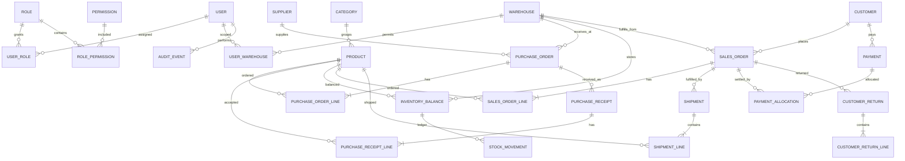

# SupplyChain Pro Database Plan

## Conventions

- PostgreSQL; Prisma schema and checked-in migrations are the source of schema change.
- UUID primary keys, `created_at`/`updated_at` timestamps in UTC, and `created_by` where meaningful.
- Use `numeric(18, 2)` for ETB amounts initially (confirm required precision and rounding); never use binary floating point for money. If multiple currencies are introduced, store currency code per document and define FX separately.
- Use integer base-unit quantities unless fractional units are confirmed. Enforce positive line quantities and nonnegative balances.
- Use restrictive foreign keys for historical records; deactivate master data instead of deleting referenced rows.
- Add indexes for foreign keys, document status/date, SKU, and common report filters after query patterns are confirmed.
- Store status as constrained enum/string with application transition validation; database constraints enforce impossible values where practical.

## ER diagram

`STOCK_MOVEMENT` should include optional source and destination warehouse (or location) references and a movement type. Its signed quantity convention must be consistent: recommendation is one immutable movement row per affected warehouse, with positive/negative quantity and a shared transfer/operation reference; alternatively use paired legs under one movement group. Balances are a transactional projection, reconciled against the ledger.

## Core entities

| Entity | Important fields and constraints |
|---|---|
| `User` | id, email unique normalized, password_hash, display_name, active, timestamps; never store plaintext password. |
| `Role`, `Permission`, `UserRole`, `RolePermission` | Named RBAC permissions; unique role-permission and user-role pairs. Avoid encoding role names as the only authorization mechanism. |
| `UserWarehouse` | user_id, warehouse_id; optional default flag; unique pair. Controls warehouse scope in addition to permissions. |
| `Warehouse` | code unique, name, address, active, timezone/config as needed. |
| `Category` | name, optional parent_id, active; prevent invalid category cycles in service. |
| `Product` | SKU unique, name, category_id, description, base_unit, barcode optional unique, active, reorder settings. Catalog quantity fields are forbidden. |
| `Supplier` | name, contacts, address, payment terms, active, external reference. |
| `Customer` | business name, contact, addresses, payment terms/credit limit if approved, active. |
| `PurchaseOrder` | number unique, supplier_id, receiving_warehouse_id, status, ordered_at, expected_at, currency, subtotal/discount/tax/total snapshots if scope confirmed, created_by, approved_by. |
| `PurchaseOrderLine` | PO, product, ordered_qty, unit_cost snapshot, received_accepted_qty derived or maintained transactionally; unique line number; positive quantities. |
| `PurchaseReceipt` / `PurchaseReceiptLine` | PO, received_at, supplier reference, receiver, status; each line records accepted/rejected/pending quantities, reason/condition and optional lot/expiry. Accepted quantity drives stock only on posting. |
| `InventoryBalance` | product_id, warehouse_id, on_hand integer, reserved integer, version; unique pair; check `on_hand >= 0`, `reserved >= 0`, `reserved <= on_hand`. Available is computed or exposed as `on_hand - reserved`. |
| `StockMovement` | movement_group_id, product_id, warehouse/location, signed qty, movement_type, reference_type/id, reason, actor_id, occurred_at; immutable. Index product/warehouse/time and references. |
| `StockReservation` | sales_order_line_id, product_id, warehouse_id, quantity, status, expires_at; individual allocations enable partial release/dispatch and audit. Balance reserved is aggregate of active reservations and must reconcile transactionally. |
| `WarehouseTransfer` / `WarehouseTransferLine` | source/destination, status, requested/dispatched/received quantities, actors and timestamps; in-transit quantity tracked explicitly; no same source/destination. |
| `SalesOrder` | number unique, customer, warehouse, status, requested delivery, currency, price/tax/discount snapshots as approved, created_by, confirmed_at. |
| `SalesOrderLine` | product, ordered_qty, unit_price snapshot, fulfilled_qty, cancelled_qty; line-level quantities support partial fulfillment. |
| `Shipment` / `ShipmentLine` | order, status, carrier/driver optional, dispatched/delivered times, proof reference and exception; quantities cannot exceed remaining allocatable order quantities. |
| `CustomerReturn` / `CustomerReturnLine` | original order/shipment optional, status, reason; product, quantity, condition, disposition (restock/quarantine/scrap), inspection actor. Only accepted restock quantity enters saleable balance. |
| `Payment` | customer, amount, currency, method, external reference, status, received_at, actor; posted and reversed records are immutable. |
| `PaymentAllocation` | payment_id, sales_order_id, amount; allocations cannot exceed payment or outstanding order balance. Allow unapplied remainder. |
| `AuditEvent` | actor_id, action, entity_type/id, occurred_at, request_id, reason, before/after JSON where appropriate; redact sensitive values and restrict update/delete access. |
| `IdempotencyRecord` | actor, operation, key, request hash, response reference, expiry; unique actor/operation/key. Retain long enough for retry window. |

## Relationships and deletion

Products belong optionally to categories; PO lines and receipts refer to suppliers, products, and receiving warehouse through their parent documents. Sales orders belong to customers and fulfillment warehouse. Shipments contain order lines and decrement inventory only at dispatch. Payments can be partially allocated across orders. Posted documents and movements are retained. User deactivation does not erase historical actor references; use nullable actor only for explicit system-generated events.

## Inventory ledger model

- Maintain `InventoryBalance` as a fast current projection, and `StockMovement` as the audit ledger. Update both in the same transaction.
- Receiving accepted units: positive `RECEIPT` movement and increase on-hand.
- Order confirmation/allocation: create active reservation and increase reserved; no on-hand movement.
- Dispatch: negative `SALE_DISPATCH` movement, decrease on-hand and reserved, and consume reservation in one transaction.
- Release/cancel/expiry: decrease reserved and close reservation; no on-hand movement.
- Transfer: source negative movement at dispatch and destination positive movement at receipt; track in-transit amount on transfer. Reconcile dispatched less received as in transit.
- Return: inspect first; restockable accepted quantity gets positive movement; quarantine/scrap is recorded in a non-saleable disposition/location or dedicated quantity state.
- Adjustment: signed movement with mandatory reason, count evidence, actor, and approval reference if threshold requires approval.
- Add periodic reconciliation that compares balance projection with sum of ledger entries and active reservations; emit an alert, never silently rewrite history.

## Migration and integrity plan

1. Create auth/RBAC and warehouse/catalog foundations.
2. Add procurement and receipt tables, then inventory ledger/balances/reservations.
3. Add sales orders, shipments, returns, and payment/allocation records.
4. Add audit/idempotency and indexes/constraints as workflows are implemented.
5. Use forward migrations; never edit an already deployed migration. Back up before production migrations and verify migration on staging data copy.

Important invariants should be backed by unique/check constraints and transactional service logic. Test that each workflow updates all dependent rows atomically. Consider database triggers only if service-only enforcement proves insufficient; avoid duplicating complex business logic in triggers.

## Decisions before schema freeze

- Whether unit quantities can be fractional and whether pack/unit conversions are required.
- Batch/lot/expiry/serial tracking and FIFO/FEFO picking requirements.
- Whether damaged/quarantined/in-transit inventory requires separate balances or warehouse locations.
- Tax/VAT, discounts, invoice numbering, multi-currency, and accounting integration.
- Reservation expiration, backorders, substitutions, and negative-stock exception policy.
- Whether to store immutable audit snapshots as JSON, normalized event rows, or both; retention policy.
